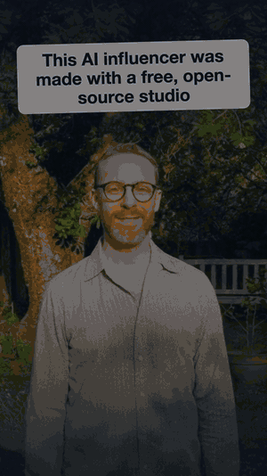

# AI Influencer Studio

[](https://kaggle.com/kernels/welcome?src=https://github.com/ItxAsim/ai-influencer-studio/blob/main/influencer_studio.ipynb)


<p align="center">
  
</p>

<p align="center"><i>Marcus, an openly AI health creator. His voice, movement, lip-sync and subtitles were made with this studio on a free Kaggle GPU.</i></p>

A free, point-and-click web app for AI-influencer videos. It runs inside one Kaggle notebook on a free GPU,
with open models and no API keys, and turns a character, one photo and a script into a finished vertical
talking video:

**character → idea → script → voice → moving video → lip-sync → subtitles and sound**

| Step | Model | What it does |
|---|---|---|
| Ideas & script | [Qwen3-4B-Instruct-2507](https://huggingface.co/Qwen/Qwen3-4B-Instruct-2507) | Writes ideas and a script in your character's voice, or use your own |
| Voice | [Qwen3-TTS](https://github.com/QwenLM/Qwen3-TTS) VoiceDesign + Base | Designs a voice from a written description once, then clones it for every script |
| Movement | [Wan 2.2 TI2V-5B](https://github.com/Wan-Video/Wan2.2) (GGUF Q8) | Turns the start photo into 5-second clips of the character breathing and moving |
| Lip-sync | [LatentSync 1.5](https://github.com/bytedance/LatentSync) | Redraws the mouth to match the voice |
| Finishing | [Remotion](https://www.remotion.dev) (ffmpeg fallback) | Hook title, word-by-word subtitles, ambient sound, camera drift, loudness |

## Quick start

1. Click **Open in Kaggle** above (or on [Kaggle](https://www.kaggle.com): **Create → New Notebook → File →
   Import Notebook** → `influencer_studio.ipynb`).
2. **Session options → Accelerator: GPU T4 x2**, **Internet: On** (needs phone verification).
3. Set `PASSWORD` in the last cell, then **Run all** (about 5 minutes).
4. Open the `https://….gradio.live` link it prints and log in as `studio` with your password.
5. Work through the tabs: **Guide → Character → Script → Voice → Video → Lip-sync & finish**.
   After the first video, **Autopilot** (Script tab) runs voice → video → lip-sync → finish in one click.

Keep the Kaggle tab open while you work; the app runs inside the notebook session. Everything is saved under
`/kaggle/working/studio`. **Export character pack** saves the character and its voice; import it in a new
session so the character always sounds the same.

A 35–50 s video takes about 1.5–2 hours on a T4 the first time, mostly video generation (~20 min per take)
and lip-sync. Kaggle gives about 30 GPU hours a week.

To run the app on your own Linux machine with an NVIDIA GPU (16 GB+): install the packages from the
notebook's setup cell, then `cd studio && python app.py`.

## What makes it look human

- **A big face.** The video model works at 480×832. Frame the start photo waist-up or closer, face at least a
  quarter of the frame width, or the eyes smear.
- **No talking in the base clips.** The clips are generated with a relaxed, closed mouth; lip-sync adds the
  speech. Takes play forward then backward and are chained, so a long voice-over has no visible jumps.
- **One voice.** A designed voice drifts between generations, so the notebook designs it once and clones that
  take for every sentence.

## Repository

```
influencer_studio.ipynb   the Kaggle notebook (generated, self-contained)
build_notebook.py         builds the notebook and embeds studio/ and remotion/ into it
studio/app.py             the web UI (Gradio)
studio/pipeline.py        the steps, shared by the UI; one folder per character on disk
studio/guide.md           how to build a character (shown in the UI and the notebook)
studio/ideas.py           ideas and scripts with a local LLM
studio/tts.py             Qwen3-TTS voice design and cloning (CUDA, own environment)
studio/wan.py             Wan 2.2 base clips
studio/text.py            script -> sentences and pauses; sentence timings -> subtitle lines
studio/media.py           fit clips to the voice, ffmpeg finishing fallback, loudness
remotion/                 the finishing template (Talking composition)
```

Edit the files, then `python build_notebook.py` to regenerate the notebook.

## Contributing

Issues and pull requests are welcome, especially: other languages, faster settings for the free GPU, new
finishing templates, and reports of what breaks on Kaggle. Please include the log from the step that failed.

## Responsible use

- Label the videos as AI-generated. TikTok, Instagram and YouTube require it for realistic AI content.
- Don't recreate or imitate a real person's face or voice.
- You are responsible for every script. Health, finance and legal niches especially: no diagnosis, no
  guarantees, no invented evidence.

## Licences

This repository's code is MIT-licensed (see `LICENSE`). The models and tools it downloads have their own
licences; check them before commercial use:
[Wan 2.2](https://github.com/Wan-Video/Wan2.2) ·
[Qwen3-TTS](https://github.com/QwenLM/Qwen3-TTS) ·
[Qwen3-4B-Instruct](https://huggingface.co/Qwen/Qwen3-4B-Instruct-2507) ·
[LatentSync](https://github.com/bytedance/LatentSync) ·
[Remotion](https://www.remotion.dev/license) (free for individuals and companies of up to 3 people;
larger companies need a company licence).
